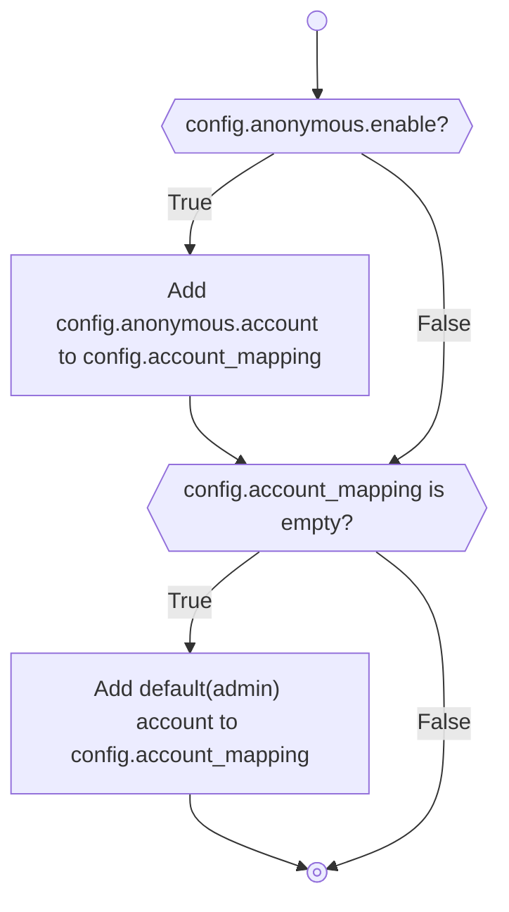
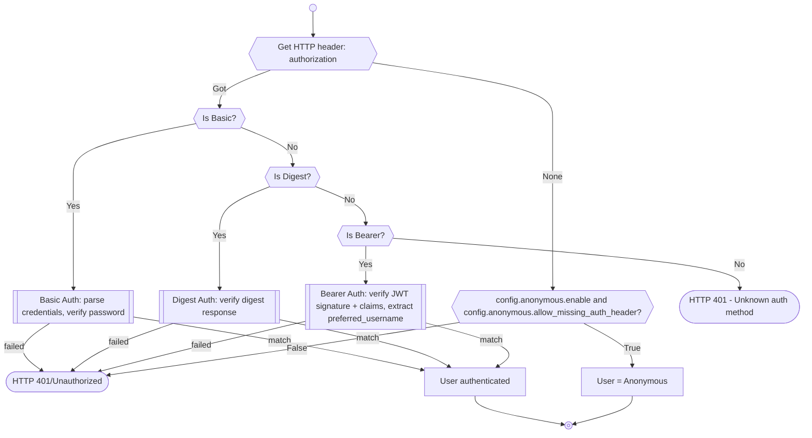

# Authentication

## Account Preprocessing

- If anonymous account are enabled, they will be automatically added to the list of accounts
- If can not found any account, the system will automatically add a default(admin) account.



## Match/Check Account

The server supports three authentication methods, checked in this order:

1. **HTTP Basic Auth** — `Authorization: Basic <base64(user:password)>`
2. **HTTP Digest Auth** — `Authorization: Digest <digest-data>`
3. **HTTP Bearer Auth (OIDC)** — `Authorization: Bearer <access_token>`
4. **Anonymous** — no `Authorization` header, falls back to the anonymous user (if enabled)



### Digest Auth limitations

HTTP Digest auth needs the plain password or its HA1 hash on the server, so it only works for accounts with a Raw or HTTP Digest mode password. Digest logins for hashlib, LDAP, `*ldap`, `*oidc` or accounts with an invalid password format are always rejected, use Basic auth for them. See [Compatibility](protect-your-password-in-the-config.en.md#compatibility).

### Bearer Auth (OIDC)

Any user the IdP (Keycloak) authenticates can use Bearer auth, whatever groups it belongs to. When a client sends `Authorization: Bearer <access_token>`:

1. The JWT is verified locally against the IdP's JWKS public keys (fetched at startup and refreshed periodically, see [JWKS keys and caching](protect-your-password-in-the-config.en.md#jwks-keys-and-caching)).
2. Claims are checked: `exp`, `iss`, `aud`, `sub` must be present, plus `azp`, `typ` ("Bearer") and `scope`.
3. The `preferred_username` claim is looked up in `account_mapping`.
4. If found, that account's permissions are used. Otherwise the user inherits the `*oidc` permissions; if those are empty (`[]`), HTTP 401 is returned.
5. If the token is invalid or malformed, HTTP 401 is returned. Keycloak groups are never used.

Shared (group-like) access is provided by dedicated accounts that log in with Basic auth, and with the WebHDFS provider HDFS enforces its own permissions for the impersonated user, see [Shared access](protect-your-password-in-the-config.en.md#shared-group-like-access) and [Two permission layers](protect-your-password-in-the-config.en.md#two-permission-layers-webhdfs).

The security of this mapping relies on the IdP guaranteeing that `preferred_username` is unique, assigned by the identity infrastructure and not changeable by users, see [Security assumption](protect-your-password-in-the-config.en.md#security-assumption-preferred_username).

See [Protect your password](protect-your-password-in-the-config.en.md#oidc-openid-connect-bearer-auth) for configuration details.

#### OpenID Connect Access Token Requirements

To authenticate using OpenID Connect, the Identity Provider (IdP) **must issue a JWT access token** containing the following claims.

The server validates these claims to ensure the token was issued by the expected provider and intended for this application.

| Claim | Required | Description |
|--------|----------|-------------|
| `iss` | Yes | The issuer of the token. Must match the configured OIDC issuer URL. |
| `aud` | Yes | The intended audience of the token. Must match the configured audience for this application. |
| `sub` | Yes | Subject identifier. Must be present (it is not used for the account mapping). |
| `azp` | Yes | The authorized party (OAuth client ID). Must match the configured client ID. |
| `typ` | Yes | Must be `Bearer` (as issued by Keycloak access tokens). |
| `scope` | Yes | Space-separated string of granted scopes. Must include the configured required scope. |
| `preferred_username` | Yes | Username of the authenticated identity, mapped to a configured account or to the `*oidc` permissions. |
| `exp` | Yes | Expiration timestamp (Unix epoch). Tokens without `exp`, or expired, are rejected. |
| `groups` | No | Not read. Group membership is neither required nor used for permissions. |

##### Example

```json
{
  "iss": "https://idp.example.com/realms/main",
  "aud": "webdav",
  "sub": "f1b2c3d4-0000-4000-8000-000000000000",
  "azp": "webdav-client",
  "typ": "Bearer",
  "scope": "openid webdav",
  "preferred_username": "alice",
  "exp": 1750000000
}
```

##### Claim validation

During authentication the server performs the following checks:

| Claim | Validation |
|--------|------------|
| `iss` | Required, must equal the configured issuer. |
| `aud` | Required, must contain the configured audience. |
| `sub` | Required. |
| `exp` | Required, must be in the future. |
| `azp` | Must equal the configured client ID. |
| `typ` | Must equal `Bearer`. |
| `scope` | Must be a string containing the required scope. |
| `preferred_username` | Must be a non-empty string, not starting with `*`. |

##### Compatibility

Most OpenID Connect providers (including Keycloak, Authentik, Authelia, Dex, Zitadel and others) can be configured to produce tokens compatible with these requirements.

The exact set of claims included in the access token depends on the provider configuration and the scopes requested by the client. In particular, `preferred_username` typically requires the `profile` scope to be granted.

## Anonymous Account

More detail, please see howto.
